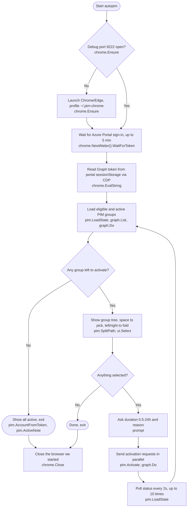

# AutoPIM

An interactive CLI that automates Azure Privileged Identity Management (PIM) group activation. Written in Go and shipped as a single dependency-free binary (about 7 MB).

It launches Chrome or Microsoft Edge in remote-debugging mode, reads a Microsoft Graph access token from your Azure Portal session, and submits PIM group activation requests.

## Background

For account-policy reasons, PIM groups cannot be activated with the Azure CLI (`az`). Activation had to be done by signing in to the Azure Portal and opening each group one by one, which took a lot of time when there were many groups.

AutoPIM was built to make this faster and easier. You still sign in to the portal once in the browser, then select groups, enter the duration and reason, and submit activation requests for multiple groups at once from the terminal.

## Requirements

- Google Chrome, Microsoft Edge, or Chromium on Linux
- An Azure Portal account with permission to activate PIM groups
- A terminal with a TTY
- Build only: Go 1.26 or later

## Usage

Download the binary for your OS from the releases page, or run from source.

```bash
go run ./cmd/autopim
```

How it works:

1. Connects to the local debugging port `9222`. If nothing is listening, it launches Chrome with a dedicated profile (`~/.pim-chrome`).
2. Waits for Azure Portal sign-in and a Graph token (up to 5 minutes).
3. You select the groups to activate (↑/↓, space, a, enter, q), then enter the duration (0.5-24h) and a reason.
4. Activation requests for the selected groups are sent in parallel, then it checks that they show as active.

Group names are split on `-` into a tree. Space on a group header selects (and unfolds) everything under it; deselecting folds it again. ←/→ fold and unfold.

## Flow



Code map:

| Step | Package |
| --- | --- |
| Launch browser, read token over CDP | `internal/chrome` |
| Graph API calls (https://graph.microsoft.com only) | `internal/graph` |
| Group listing, activation, name splitting | `internal/pim` |
| Tree selector UI | `internal/ui` |
| Flow control | `cmd/autopim` |

## Build

```bash
go build -trimpath -ldflags "-s -w" -o dist/autopim ./cmd/autopim
```

To cross-compile for another OS, just set `GOOS`/`GOARCH`.

```bash
GOOS=windows GOARCH=amd64 go build -trimpath -ldflags "-s -w" -o dist/autopim-windows-x64.exe ./cmd/autopim
GOOS=windows GOARCH=arm64 go build -trimpath -ldflags "-s -w" -o dist/autopim-windows-arm64.exe ./cmd/autopim
GOOS=linux   GOARCH=amd64 go build -trimpath -ldflags "-s -w" -o dist/autopim-linux-x64 ./cmd/autopim
GOOS=linux   GOARCH=arm64 go build -trimpath -ldflags "-s -w" -o dist/autopim-linux-arm64 ./cmd/autopim
GOOS=darwin  GOARCH=amd64 go build -trimpath -ldflags "-s -w" -o dist/autopim-macos-x64 ./cmd/autopim
GOOS=darwin  GOARCH=arm64 go build -trimpath -ldflags "-s -w" -o dist/autopim-macos-arm64 ./cmd/autopim
```

GitHub Actions (`.github/workflows/build.yml`) runs the tests on macOS, Linux, and Windows and builds binaries for 6 targets (macOS, Linux, Windows × x64, arm64). Pushing a `v*` tag attaches them to a release automatically.

## Platform Notes

- Browser lookup paths are in [internal/chrome/platform.go](internal/chrome/platform.go). To support a browser installed elsewhere, add its path to `Candidates()`.
- To detect a debug Chrome left over from a previous run, macOS/Linux use `lsof`/`ps` (Linux needs the `lsof` and `procps` packages) and Windows uses PowerShell.
- The full sign-in flow on Windows has not been verified on a real machine.
- Binaries are unsigned, so macOS Gatekeeper / Windows SmartScreen warnings may appear.

## Security Notes

- The debugging port binds only to `127.0.0.1`, but other processes on the same machine can still access it. Run only in a trusted environment.
- The access token is never printed or stored; it is kept in memory only.

## Development

```bash
go vet ./...
go test ./...
```

```text
cmd/autopim/       Entry point, interactive flow
internal/chrome/   Chrome launch/shutdown, CDP communication, per-platform lookup
internal/graph/    Microsoft Graph client
internal/pim/      PIM group domain logic
internal/ui/       Checkbox selection UI
```
